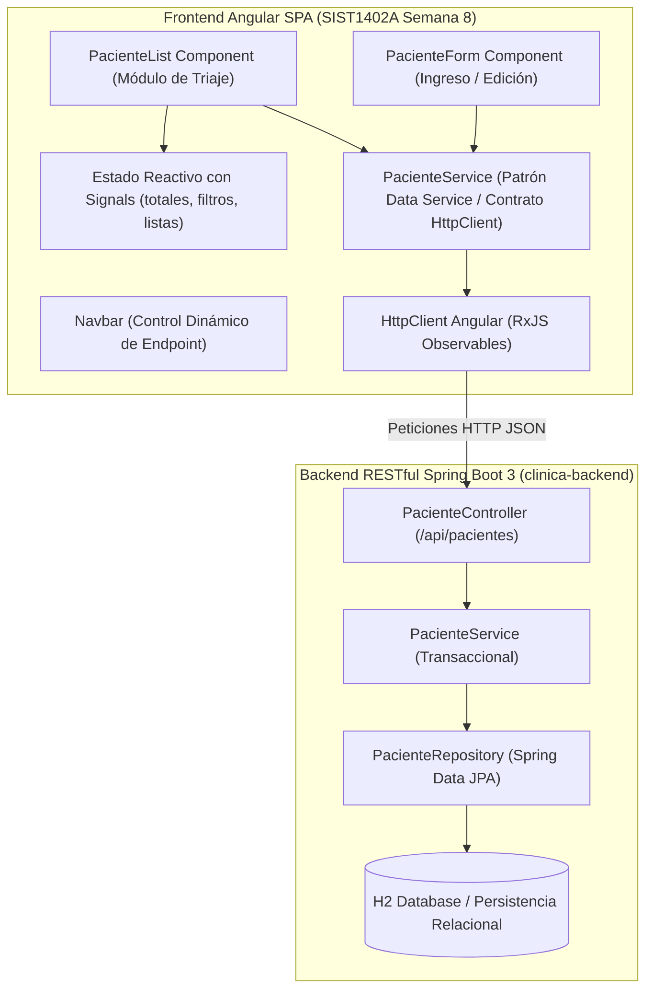

# Clinical Patient Triage SPA Architecture - Angular Service & Spring Boot REST API Integration (SIST1402A Lab 08)

[](https://angular.dev/)
[](https://www.typescriptlang.org/)
[](https://getbootstrap.com/)
[](https://spring.io/projects/spring-boot)
[](https://vitest.dev/)
[](https://junit.org/junit5/)

> Repositorio de portafolio profesional desarrollado para la asignatura Soluciones Web y Aplicaciones Distribuidas (Codigo SIST1402A - Semana 08 Laboratorio 08) en la Universidad Privada del Norte (UPN). Implementa la solucion integral full-stack del flujo clinico de triaje y atencion ambulatoria, construyendo un servicio Angular (`PacienteService`) con `HttpClient` para consumir un backend RESTful real en Spring Boot 3, gestion reactiva de estado mediante Signals y validacion estricta de formularios medicos.

---

## 1. Resumen Ejecutivo para Evaluadores Tecnicos

El objetivo pedagogico y tecnologico de esta practica es materializar el flujo arquitectonico corporativo:

```
Componente -> Servicio -> HTTP (HttpClient / RxJS) -> API REST (Spring Boot) -> Base de Datos -> Vista Reactiva
```

Esta solucion resuelve la transicion definitiva desde datos simulados en memoria (Mock) hacia la integracion asincrona con un backend distribuido, demostrando:

1. **Cumplimiento del Contrato Base Institucional**: Implementacion estricta del metodo `listar(): Observable<Paciente[]>` en `PacienteService`, canalizando el consumo del endpoint `/api/pacientes` a traves de `HttpClient`.
2. **Gestion Clinica de Triaje con Angular Signals**: Estado reactivo mediante primitivas `signal()` y `computed()` para metricas en tiempo real: conteo de atenciones criticas (Prioridad 1), intermedias y ambulatorias, con filtros sincronos por severidad.
3. **Formulario Reactivo de Admision**: Captura controlada mediante `FormBuilder`, implementando validaciones de negocio como formato estricto de DNI (8 digitos numericos), rangos de edad validos y descripcion clinica obligatoria.
4. **Backend RESTful Integrado**: Servicio Spring Boot 3 autonomo en la carpeta `backend/`, con persistencia JPA, endpoints CRUD, seed de historias clinicas y pruebas unitarias/integracion con MockMvc.

---

## 2. Diagrama de Arquitectura de Integracion

El siguiente diagrama detalla la arquitectura desacoplada implementada entre el frontend Angular y el microservicio backend de historias clinicas:




---

## 3. Especificacion de Contratos y Endpoints

Ruta base del backend: `/api/pacientes`

| Operacion | Metodo Angular | Verbo HTTP | Endpoint | Descripcion Tecnica |
|---|---|---|---|---|
| Listar historias | `listar()` | `GET` | `/api/pacientes` | Devuelve `Observable<Paciente[]>` con la lista completa de pacientes activos |
| Consultar por ID | `buscarPorId(id)` | `GET` | `/api/pacientes/{id}` | Recupera la ficha medica para edicion en el formulario |
| Ingreso a triaje | `registrar(p)` | `POST` | `/api/pacientes` | Da de alta un nuevo ingreso clinico validado |
| Actualizar ficha | `actualizar(id, p)` | `PUT` | `/api/pacientes/{id}` | Actualiza diagnostico o nivel de prioridad |
| Alta medica | `eliminar(id)` | `DELETE` | `/api/pacientes/{id}` | Retira al paciente del panel activo de triaje |
| Filtro por severidad | `filtrarPorTriaje(t)` | `GET` | `/api/pacientes/triaje?triaje={t}` | Consulta remota filtrada por nivel de triaje |

### Modelo de Datos `Paciente`
- `id`: Identificador numerico generado por el backend.
- `nombre`: Apellidos y nombres del paciente.
- `edad`: Edad cronologica en anos.
- `dni`: Documento Nacional de Identidad (8 digitos).
- `diagnostico`: Sintoma, motivo de consulta o diagnostico preliminar.
- `triaje`: Nivel de clasificacion medica (`Critico` | `Medio` | `Bajo`).
- `activo`: Estado de atencion hospitalaria.
- `fechaIngreso`: Fecha ISO de recepcion.
- `telefono`: Numero de contacto.

---

## 4. Estructura del Repositorio

```
SWAD-SIST1402A-S08-angular-paciente-service-spring-boot/
├── backend/                               # Microservicio Spring Boot 3
│   ├── src/
│   │   ├── main/java/com/upn/clinica/
│   │   │   ├── config/DataInitializer.java    # Seeder de pacientes iniciales
│   │   │   ├── controller/PacienteController.java
│   │   │   ├── model/Paciente.java            # Entidad JPA
│   │   │   ├── repository/PacienteRepository.java
│   │   │   ├── service/PacienteService.java
│   │   │   └── ClinicaApplication.java
│   │   └── resources/application.properties
│   │   └── test/java/com/upn/clinica/PacienteControllerTest.java # Tests MockMvc
│   ├── mvnw / mvnw.cmd
│   └── pom.xml
├── mermaid diagramas/
│   ├── arquitectura.mmd                   # Fuente Mermaid
│   └── arquitectura.svg                   # Diagrama compilado SVG
├── src/                                   # Frontend Angular 22
│   ├── app/
│   │   ├── components/navbar/
│   │   ├── models/paciente.model.ts
│   │   ├── pages/
│   │   │   ├── paciente-list/             # Listado de triaje, metricas y filtros
│   │   │   └── paciente-form/             # Formulario reactivo
│   │   ├── services/paciente.service.ts   # Contrato HttpClient
│   │   ├── app.config.ts
│   │   ├── app.routes.ts
│   │   └── app.ts
│   ├── environments/
│   ├── main.ts
│   └── styles.scss
├── angular.json
├── package.json
└── tsconfig.json
```

---

## 5. Instrucciones de Ejecucion y Verificacion

### Paso 1: Iniciar el Backend Spring Boot (Terminal 1)
```bash
cd backend
./mvnw spring-boot:run
```
El backend iniciara en el puerto `8080`, exponiendo la API en `http://localhost:8080/api/pacientes` con los datos precargados.

### Paso 2: Iniciar el Frontend Angular (Terminal 2)
```bash
npm install
npm start
```
El frontend iniciara en el puerto dedicado `4201` para evitar colisiones con el Laboratorio 08.
Abrir el navegador en `http://localhost:4201/pacientes`.

---

## 6. Registro de Pruebas Automatizadas

### Pruebas de Frontend (Angular Testing + Vitest)
Ejecutar:
```bash
npm test
```
Resultado:
```
Test Files  3 passed (3)
     Tests  15 passed (15)
  Duration  4.48s
```

### Pruebas de Backend (JUnit 5 + MockMvc)
Ejecutar:
```bash
cd backend
mvn test
```
Resultado:
```
[INFO] Tests run: 7, Failures: 0, Errors: 0, Skipped: 0
[INFO] BUILD SUCCESS
```

### Compilacion de Produccion
```bash
npm run build
```
Resultado: Paquete optimizado generado en `dist/` en 6.9 segundos.

---

## 7. Informacion Academica
- **Institucion**: Universidad Privada del Norte (UPN)
- **Curso**: Soluciones Web y Aplicaciones Distribuidas (SIST1402A)
- **Periodo**: 2026-II
- **Estudiante**: Orlando Dorival
